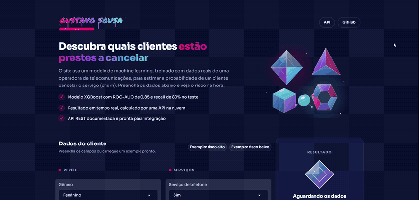
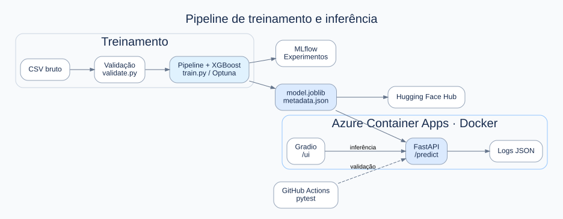

# Telco Customer Churn

Projeto de Ciência de Dados para prever o cancelamento de clientes de telecomunicações. O modelo XGBoost recebe o perfil do cliente e retorna a probabilidade de churn e uma classificação de risco, apoiando estratégias de retenção.

**Em produção no Microsoft Azure:** [Testar aplicação](https://telco-churn-api.niceocean-f7122f5d.brazilsouth.azurecontainerapps.io/ui/?__theme=dark)

**Modelo publicado:** [Hugging Face Hub](https://huggingface.co/GustavoSousa/telco-churn-xgboost)

## Destaques

- **Modelagem:** comparação entre Regressão Logística, Random Forest e XGBoost, com otimização via Optuna.
- **Resultados:** recall de 79,9%, ROC-AUC de 0,848 e PR-AUC de 0,661 em 1.409 clientes de teste.
- **Decisão de negócio:** threshold selecionado para identificar cerca de 80% dos clientes que cancelam.
- **Ciclo completo:** pipeline Python, MLflow, FastAPI, Gradio, testes, GitHub Actions, Docker e Azure Container Apps.

## Demonstração

<p align="center">
  <a href="assets/demo.mp4"></a>
</p>

Gravação da aplicação em produção. [Assistir ao vídeo completo (MP4)](assets/demo.mp4).

## Por que fiz isso

O cancelamento de clientes é um problema de classificação com impacto direto na receita. A proposta é identificar clientes com maior risco de churn antes do cancelamento, permitindo que a empresa priorize ações de retenção.

Neste cenário, assume-se que perder um cliente custa mais do que realizar uma ação de retenção desnecessária. Por isso, o modelo prioriza recall da classe churn, aceitando parte dos falsos positivos. O custo e a efetividade da intervenção precisam ser validados pelo negócio.

Também é um projeto de portfólio: o objetivo foi percorrer o ciclo de vida de Machine Learning, da análise exploratória e experimentação até a disponibilização do modelo em uma aplicação real, com testes e rastreamento de experimentos.

## Como funciona



1. O CSV bruto passa pela validação de dados e pelo contrato de features.
2. A análise e a experimentação nos notebooks orientam a seleção do modelo. A limpeza e o pré-processamento são incorporados ao pipeline Python.
3. O treinamento otimiza hiperparâmetros, define o corte de decisão e registra os experimentos no MLflow.
4. O pipeline treinado e seus metadados são salvos em `model/`, permitindo reutilizar as mesmas transformações na inferência.
5. A FastAPI recebe os dados do cliente e retorna a probabilidade de churn, a decisão e o threshold. O Gradio disponibiliza uma interface para testar o modelo.

A separação entre treinamento e inferência evita que seja necessário executar notebooks ou retreinar o modelo a cada requisição.

## Modelagem e avaliação

### Seleção do modelo

Foram comparados três algoritmos em validação cruzada aninhada. A otimização do XGBoost foi realizada com Optuna (50 trials), utilizando PR-AUC como objetivo, uma métrica relevante para problemas com classes desbalanceadas.

| Modelo | PR-AUC média na validação cruzada |
|---|---:|
| XGBoost | **0,672 ± 0,018** |
| Random Forest | 0,666 |
| Regressão Logística | 0,661 |

O XGBoost foi selecionado por apresentar as melhores médias de ROC-AUC e PR-AUC. Entretanto, os intervalos de bootstrap das diferenças no teste contêm zero, portanto não há evidência suficiente para afirmar superioridade estatística. A Regressão Logística continua sendo uma alternativa mais simples de interpretar.

### Resultados no conjunto de teste

Avaliação em 1.409 clientes, com o corte definido exclusivamente a partir dos dados de treinamento.

| Métrica | Resultado | Interpretação |
|---|---:|---|
| Recall (churn) | **79,9%** | Parcela dos cancelamentos reais identificada |
| Precisão (churn) | 51,3% | Parcela dos alertas que corresponde a cancelamentos reais |
| ROC-AUC | 0,848 | Capacidade de ordenar positivos acima de negativos |
| PR-AUC | 0,661 | Desempenho na relação entre precisão e recall |
| Threshold | 0,512 | Corte utilizado na decisão de classificação |

### Por que não usar o corte padrão de 0,5?

O corte foi escolhido como o maior valor cujo recall out-of-fold no treinamento ainda atingia 80%. Ele é salvo em `model/metadata.json` e utilizado pela API. O conjunto de teste não participou dessa escolha.

### Consistência entre treino e produção

O pipeline salvo recebe as colunas brutas e aplica a limpeza, one-hot encoding, padronização e predição. Dessa forma, as transformações usadas no treinamento são reutilizadas na API, reduzindo o risco de divergência entre treino e inferência.

## Deploy no Azure

A aplicação está disponibilizada no Azure Container Apps. A API FastAPI e a interface Gradio são empacotadas em Docker, mantendo as dependências do ambiente de execução.

| Componente | Responsabilidade |
|---|---|
| Azure Container Apps | Hospedagem da aplicação em produção |
| Docker | Empacotamento do ambiente e das dependências |
| FastAPI | Serviço de inferência e documentação da API |
| Gradio | Interface para informar o perfil e visualizar o resultado |
| Hugging Face Hub | Distribuição do modelo e seu model card |

O navegador acessa a interface `/ui`, os dados são encaminhados para inferência e o pipeline retorna o risco de churn. O threshold registrado nos metadados determina a classificação final. Cada predição gera um registro nos logs da aplicação.

**Acessos públicos:** [Interface em produção](https://telco-churn-api.niceocean-f7122f5d.brazilsouth.azurecontainerapps.io/ui/?__theme=dark) · [Modelo no Hugging Face](https://huggingface.co/GustavoSousa/telco-churn-xgboost).

## Experimentos, testes e CI

O MLflow registra os parâmetros, métricas e artefatos associados ao treinamento. O pipeline e os metadados são versionados para permitir a reutilização do modelo.

Os testes automatizados com pytest abrangem dados, modelo e API. O GitHub Actions executa os testes como parte da integração contínua, e o Docker permite reproduzir o ambiente de execução.

## Stack

| Parte | Tecnologia |
|---|---|
| Linguagem | Python |
| Modelagem | Scikit-learn e XGBoost |
| Otimização | Optuna |
| Experimentos | MLflow |
| API | FastAPI |
| Interface | Gradio |
| Testes e CI | pytest e GitHub Actions |
| Containerização | Docker |
| Cloud | Azure Container Apps |
| Distribuição do modelo | Hugging Face Hub |

## Como rodar localmente

Todos os comandos partem da raiz do repositório. Esta seção é destinada a quem deseja reproduzir o projeto, não é necessária para testar a aplicação publicada.

```bash
git clone https://github.com/GustavoSousa777/Telco-Customer-Churn.git
cd Telco-Customer-Churn

python -m venv .venv
source .venv/bin/activate  # Linux/macOS
# Windows PowerShell: .\.venv\Scripts\Activate.ps1
pip install -r requirements-dev.txt

python -m src.train          # treina, salva em model/ e registra no MLflow
python -m pytest -q
uvicorn src.app.main:app --port 7860                 # /docs e /ui
```

Em outro terminal, para acompanhar os experimentos:

```bash
mlflow ui --backend-store-uri sqlite:///mlflow.db
```

O MLflow roda na porta 5000. Na porta 7860, a API disponibiliza `/ui` (interface) e `/docs` (documentação interativa). Esses endereços são locais ao ambiente de desenvolvimento.

### Docker

```bash
docker build -t telco-churn .
docker run --rm -p 7860:7860 telco-churn
```

Publicar o modelo no Hugging Face Hub (precisa de um token de escrita na variável `HF_TOKEN`):

```bash
python -m src.publish_model --repo-id GustavoSousa/telco-churn-xgboost --github-url https://github.com/GustavoSousa777/Telco-Customer-Churn
```

## API

```bash
curl -X POST localhost:7860/predict -H "Content-Type: application/json" -d '{
  "gender": "Female", "SeniorCitizen": 0, "Partner": "No", "Dependents": "No",
  "tenure": 2, "PhoneService": "Yes", "MultipleLines": "No",
  "InternetService": "Fiber optic", "OnlineSecurity": "No", "OnlineBackup": "No",
  "DeviceProtection": "No", "TechSupport": "No", "StreamingTV": "No",
  "StreamingMovies": "No", "Contract": "Month-to-month", "PaperlessBilling": "Yes",
  "PaymentMethod": "Electronic check", "MonthlyCharges": 80.5
}'
```

Resposta: `{"churn_probability": 0.864, "churn_prediction": true, "threshold": 0.5119}`. `TotalCharges` é opcional (se omitido, usa `tenure * MonthlyCharges`).

## Estrutura do projeto

```text
Telco-Customer-Churn/
├── assets/
│   ├── demo.gif                demonstração animada
│   ├── demo.mp4                gravação completa
│   └── arquitetura.svg         diagrama do pipeline
├── notebooks/                  análise e experimentação
├── src/
│   ├── features.py             contrato de entrada
│   ├── data/
│   │   ├── validate.py         validação dos dados
│   │   └── clean.py            limpeza compartilhada
│   ├── pipeline.py             pré-processamento e modelo
│   ├── train.py                treinamento, threshold e MLflow
│   ├── publish_model.py        publicação no Hugging Face
│   └── app/                    FastAPI e Gradio
├── model/
│   ├── model.joblib            pipeline treinado
│   └── metadata.json           metadados e corte de decisão
├── tests/                      testes automatizados
├── Dockerfile
├── requirements-dev.txt
└── README.md
```

## Monitoramento

Cada predição gera uma linha JSON nos logs do host (contrato, tenure, probabilidade, decisão, latência), sem dados pessoais completos. Para detectar drift, o plano é comparar periodicamente a distribuição das entradas em produção (tenure, MonthlyCharges, contrato, tipo de internet) com a do treino, e a taxa de alertas com a taxa esperada. Se divergirem de forma persistente, retreinar com dados novos. Hoje o monitoramento é por logs, e relatórios automáticos (por exemplo com Evidently) são o próximo passo.

## Limitações conhecidas

O dataset é público e de um único período, então o modelo não captura sazonalidade nem mudanças de preço. A precisão de 51,3% significa que quase metade dos alertas é falso positivo. A viabilidade da estratégia depende do custo da ação de retenção, da perda evitada e da efetividade da intervenção.

## Próximos passos

- Automatizar relatórios de drift, por exemplo com Evidently.
- Acompanhar precisão e recall em produção quando os rótulos reais de cancelamento estiverem disponíveis.
- Avaliar o custo e a efetividade das ações de retenção para revisar o threshold.

## Autor

Gustavo Sousa · [GitHub](https://github.com/GustavoSousa777) · [LinkedIn](https://linkedin.com/in/gustavosousa777)
