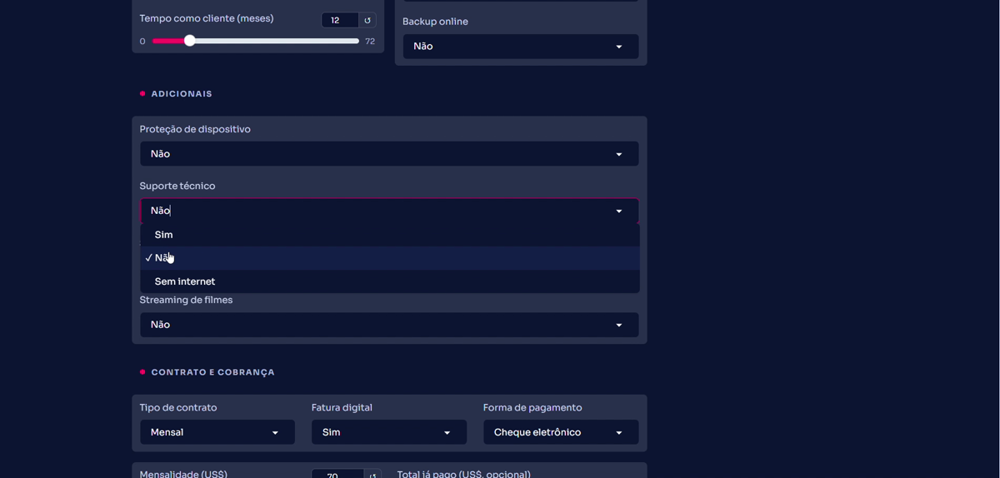
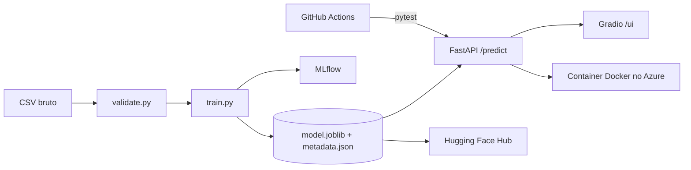

# Telco Customer Churn | Machine Learning em produção


Projeto end-to-end de Ciência de Dados para previsão de cancelamento de clientes de telecomunicações. Da experimentação em notebooks à disponibilização do modelo em produção, com validação de dados, pipeline de Machine Learning, rastreamento de experimentos, API REST, interface interativa e containerização.

## Demonstração da aplicação

A aplicação permite informar o perfil de um cliente e obter a probabilidade de churn e a decisão do modelo em tempo real.

[](https://telco-churn-api.niceocean-f7122f5d.brazilsouth.azurecontainerapps.io/ui/?__theme=dark)
[](https://huggingface.co/GustavoSousa/telco-churn-xgboost)

### Vídeo demonstrativo

[](assets/demo.mp4)

[Assistir ou baixar o vídeo completo (MP4)](assets/demo.mp4)

### Resultados em destaque

| Modelo | Recall (churn) | ROC-AUC | PR-AUC |
|---|---:|---:|---:|
| XGBoost | 79,9% | 0,848 | 0,661 |

Resultados no conjunto de teste de 1.409 clientes.

## Problema de negócio

Neste cenário, assume-se que perder um cliente custa mais do que oferecer uma ação de retenção a quem permaneceria. Por isso o modelo é calibrado para **capturar cerca de 80% dos clientes que vão cancelar**, aceitando que parte dos alertas serão falsos positivos.

## Arquitetura e fluxo de Machine Learning



## Modelagem e avaliação

XGBoost com hiperparâmetros otimizados via Optuna (50 trials, PR-AUC em validação cruzada). O pipeline salvo recebe as **colunas brutas** e faz sozinho a limpeza, o one-hot, a padronização e a predição, então treino e inferência não divergem.

**Resultados no conjunto de teste (1.409 clientes), no corte de decisão escolhido:**

| Métrica | Valor |
|---|---|
| Recall (churn) | 0,799 |
| Precisão (churn) | 0,513 |
| ROC-AUC | 0,848 |
| PR-AUC | 0,661 |

**Por que XGBoost.** Na validação cruzada aninhada, o XGBoost teve o melhor PR-AUC (0,672 ± 0,018), à frente de Random Forest (0,666) e Regressão Logística (0,661). A diferença para os outros dois fica dentro do ruído (os intervalos do bootstrap no teste contêm zero). O XGBoost foi mantido por ter as melhores médias em ROC-AUC e PR-AUC, e a Regressão Logística continua uma alternativa mais simples de explicar.

**Por que esse corte.** O corte (0,512) é o maior valor cujo recall out-of-fold no treino ainda atinge 0,80. Ele é calculado no treino e salvo em `model/metadata.json`, e a API lê esse arquivo. O corte nunca foi ajustado olhando o conjunto de teste.

## Execução local

```bash
python -m venv .venv
source .venv/bin/activate  # Linux/macOS
# Windows PowerShell: .\.venv\Scripts\Activate.ps1
pip install -r requirements-dev.txt

python -m src.train          # treina, salva em model/ e registra no MLflow
python -m pytest -q
uvicorn src.app.main:app --port 7860                 # /docs e /ui
```

Em outro terminal, para acompanhar os experimentos:

```bash
mlflow ui --backend-store-uri sqlite:///mlflow.db
```

MLflow: http://localhost:5000. Interface: http://localhost:7860/ui. Documentação da API: http://localhost:7860/docs.

### Docker

```bash
docker build -t telco-churn .
docker run --rm -p 7860:7860 telco-churn
```

Publicar o modelo no Hugging Face Hub (precisa de um token de escrita na variável `HF_TOKEN`):

```bash
python -m src.publish_model --repo-id GustavoSousa/telco-churn-xgboost --github-url https://github.com/GustavoSousa777/Telco-Customer-Churn
```

## API

```bash
curl -X POST localhost:7860/predict -H "Content-Type: application/json" -d '{
  "gender": "Female", "SeniorCitizen": 0, "Partner": "No", "Dependents": "No",
  "tenure": 2, "PhoneService": "Yes", "MultipleLines": "No",
  "InternetService": "Fiber optic", "OnlineSecurity": "No", "OnlineBackup": "No",
  "DeviceProtection": "No", "TechSupport": "No", "StreamingTV": "No",
  "StreamingMovies": "No", "Contract": "Month-to-month", "PaperlessBilling": "Yes",
  "PaymentMethod": "Electronic check", "MonthlyCharges": 80.5
}'
```

Resposta: `{"churn_probability": 0.864, "churn_prediction": true, "threshold": 0.5119}`. `TotalCharges` é opcional (se omitido, usa `tenure * MonthlyCharges`).

## Estrutura do repositório

```
assets/demo.mp4        vídeo demonstrativo
assets/demo-preview.png prévia do vídeo
src/features.py        contrato de colunas e valores aceitos
src/data/validate.py   validação do CSV bruto
src/data/clean.py      limpeza usada no treino e na API
src/pipeline.py        Pipeline único (limpeza, pré-processamento, XGBoost)
src/train.py           treino, corte, métricas e MLflow
src/app/               API FastAPI e interface Gradio
tests/                 dados, modelo e API
src/publish_model.py   publica o modelo e o model card no Hugging Face Hub
model/                 model.joblib e metadata.json (versionados)
notebooks/             análise e tuning originais
```

## Monitoramento e próximos passos

Cada predição gera uma linha JSON nos logs do host (contrato, tenure, probabilidade, decisão, latência), sem dados pessoais completos. Para detectar drift, o plano é comparar periodicamente a distribuição das entradas em produção (tenure, MonthlyCharges, contrato, tipo de internet) com a do treino, e a taxa de alertas com a taxa esperada. Se divergirem de forma persistente, retreinar com dados novos. Hoje o monitoramento é por logs, e relatórios automáticos (por exemplo com Evidently) são o próximo passo.

## Limitações

O dataset é público e de um único período, então o modelo não captura sazonalidade nem mudanças de preço. A precisão de 51,3% significa que quase metade dos alertas é falso positivo. A viabilidade da estratégia depende do custo da ação de retenção, da perda evitada e da efetividade da intervenção.
